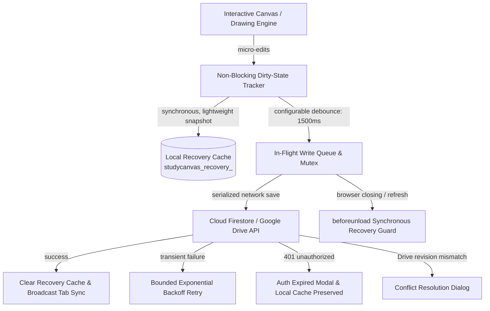

# StudyCanvas Reliable Persistence, Recovery & Conflict Resolution Guide

StudyCanvas implements a multi-tier, zero-data-loss persistence architecture engineered specifically for real-time educational whiteboards. It harmonizes high-frequency canvas drawing interactions (60+ FPS) with Cloud Firestore metadata persistence, Google Drive document file synchronization, and local emergency recovery caching.

---

## Architecture Overview

---

## 1. Non-Blocking Autosave with Configurable Debounce

- **Zero Interaction Lag**: Drawing strokes, eraser actions, sticky notes, and mathematical formula modifications do not block the UI thread or cause frame drops.
- **Configurable Debounce Window**: Rapid pen movements and element transformations are queued locally and debounced (default `1500ms`), preventing excessive network writes while guaranteeing that pausing for more than 1.5 seconds triggers a cloud save.
- **Dirty-State Tracking**: When the canvas is clean, no network requests are sent.

---

## 2. Status Indicators & Real-Time Feedback

The whiteboard navbar displays real-time badges indicating document persistence status:

| Status Badge | Icon | Description |
| :--- | :--- | :--- |
| **`Saving...`** | Spin Loader | A serialized document write is traversing the network. |
| **`Saved`** | Green Cloud Check | All changes are confirmed saved in Cloud Firestore / Google Drive. |
| **`Save failed`** | Red Alert Circle | Cloud write failed after 4 retries. Work is preserved safely in the local recovery cache. |
| **`Offline`** | Slate Cloud Off | No internet connectivity. Edits are accumulated locally; automatically flushes upon reconnecting. |
| **`Conflict`** | Amber Alert Triangle | A newer cloud or cross-tab revision was detected. Opens the 3-Way Conflict Resolver. |
| **`Auth Expired`**| Amber Key Round | Google Drive OAuth token expired (401). Prompts reauthentication without data loss. |

---

## 3. Local Recovery Drafts & Crash Protection

- **Local Storage Isolation**: LocalStorage is **never** treated as the permanent source of truth for cloud documents. Instead, recovery snapshots are stored in dedicated keys (`studycanvas_recovery_${projectId}`).
- **Crash & Tab Close Recovery**: If the browser crashes, computer loses power, or the tab is closed unexpectedly, reopening StudyCanvas will prompt:
  > **"Unsaved Work Detected"**  
  > *"StudyCanvas recovered unsaved drawings from an interrupted browser session."*
- **User Actions**:
  - **Restore Unsaved Edits**: Loads the local recovery snapshot and flushes it to the cloud.
  - **Discard Draft**: Removes the recovery draft and keeps the cloud-saved version.

---

## 4. Multi-Tab & Multi-Device Conflict Detection

When multiple tabs or devices edit the same project concurrently, StudyCanvas prevents silent data loss:

### Concurrency Channels
1. **Cross-Tab Concurrency**: Employs a browser `BroadcastChannel` (`studycanvas_project_sync_channel`) tagged with unique `TAB_ID`s. When another tab writes to the same project while the current tab has unsaved edits, conflict mode is triggered immediately.
2. **Google Drive Revisions**: Google Drive file metadata and revision IDs (`driveRevisionId` / `modifiedTime`) are verified before updating cloud files. If a remote modification occurred since the last fetch, a `DriveConflictError` is raised.

### 3-Way Conflict Resolution Modal
When a conflict is detected, the user is presented with three safe choices:
1. **Save as a Separate Copy** *(Recommended)*: Clones the current local whiteboard into a new project (`Title (Recovered Copy)`) so both versions are preserved.
2. **Keep My Version (Overwrite Cloud)**: Forces an update of the cloud document with the active tab's drawings.
3. **Load Cloud Version (Discard Local)**: Discards local unconfirmed edits and pulls the latest revision from Cloud Firestore or Google Drive.

---

## 5. Network Retries with Bounded Exponential Backoff

- Transient network errors (HTTP 500, 502, 503, 504, or network timeouts) are automatically retried up to **4 times**.
- Delays use exponential backoff (`1000ms`, `2000ms`, `4000ms`, `8000ms`, capped at `10000ms`).
- In-flight writes are serialized via a single-promise mutex: newer edits made while a write is traversing the network will never be overwritten by stale in-flight responses.

---

## 6. Authentication Expiry & Zero-Data-Loss Reauthentication

- If a user's Google Identity Services access token expires (`401 Unauthorized`), StudyCanvas halts network attempts and preserves the local recovery cache.
- An **Auth Expired Modal** opens with a 1-click **"Reconnect Google Drive"** flow.
- Once reauthorized, the pending write is automatically flushed to Google Drive and Firestore with zero data loss.

---

## 7. Schema Versioning & Safe Migration

- Projects are versioned using semantic schema versions (`schemaVersion: "2.0.0"`).
- Older documents or legacy project files created without new element properties (e.g. math formulas, function graphs, mindmap nodes, flowchart blocks, or tables) are safely migrated on load via `migrateProject()` in `schemaMigration.ts`.

---

## 8. Google Drive Revision History & Rollback Recovery

- **Automated Revisions**: Every confirmed Google Drive upload creates an immutable cloud revision.
- **Version History Browser**: Accessible directly from the whiteboard top toolbar via the **History** button.
- **Browse & Preview**: Teachers and students can view all timestamped revisions, file sizes, and revision counts.
- **1-Click Rollback**: Selecting **"Restore"** on any past revision downloads that snapshot and commits it as the new head revision on Google Drive, ensuring complete auditability and peace of mind.

---

## 9. Asset Externalization & Performance Optimization

- **No Repeated Megabyte Serializations**: Large images (base64 data URLs > 32KB) and PDF background assets are isolated into an asset manifest (`DriveAssetManifest`).
- **Lean Drawing Engine**: During rapid freehand drawing, sticky note typing, or shape resizing, serializing the document snapshot does NOT re-encode megabytes of image strings.
- **LocalStorage Quota Protection**: Emergency local recovery drafts stored during `beforeunload` or rapid auto-saves use compact asset references, preventing browser `QuotaExceededError` exceptions.
- **Transparent Hydration**: The canvas rendering engine seamlessly resolves asset tokens into full image sources on demand.
